  

  <h1>Hi, I'm Arpan Mal 👋</h1>
  <h3>Aspiring Software Developer | Frontend Development Enthusiast</h3>

  

    I enjoy building clean, responsive web experiences and improving my programming skills
    through hands-on projects.
  

  

    <a href="https://github.com/Arpanriju">GitHub</a> •
    <a href="https://www.linkedin.com/in/arpan-mal-946520310">LinkedIn</a> •
    <a href="mailto:arpanmal2003@gmail.com">Email</a>
  

---

## 🚀 About Me

- 🎓 B.Tech in Computer Science and Engineering
- 💻 Interested in frontend and software development
- 🌱 Currently strengthening my skills in JavaScript, React, and modern CSS
- 🛠️ I learn by building projects and improving them step by step
- 🤝 Open to learning opportunities, collaboration, and entry-level roles

## 🧰 Skills

**Languages:** Java, C, JavaScript, SQL  
**Frontend:** HTML5, CSS3, React.js, Tailwind CSS  
**Tools & Platforms:** Git, GitHub  
**Additional Skills:** Basic Graphic Design, Social Media Management

## 📌 Featured Project

### 🍽️ Restaurant Website
A restaurant website project built with HTML and CSS, using a custom layout, typography, and visual styling.

- **Repository:** [Resturant-Website](https://github.com/Arpanriju/Resturant-Website)
- **Technologies:** HTML, CSS

> Project description is based on the information currently available. Update this section if the repository uses additional technologies or features.

## 📊 GitHub

- Explore my repositories: [github.com/Arpanriju](https://github.com/Arpanriju)
- View my contribution activity directly on my GitHub profile.

<!-- Optional: Add verified certifications, project demos, and GitHub statistics here later. -->

## 🤝 Connect with Me

- **LinkedIn:** [arpan-mal-946520310](https://www.linkedin.com/in/arpan-mal-946520310)
- **Email:** [arpanmal2003@gmail.com](mailto:arpanmal2003@gmail.com)
- **GitHub:** [Arpanriju](https://github.com/Arpanriju)

---

  <i>Keep learning. Keep building. Keep improving.</i>

